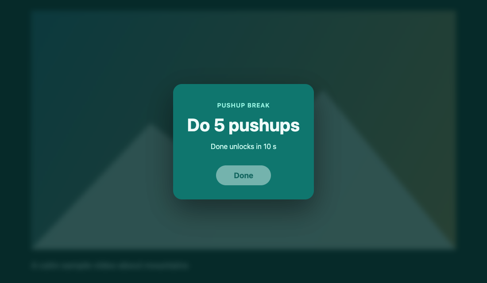
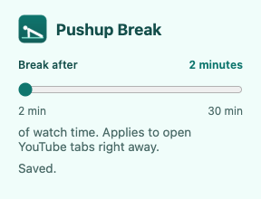

# Pushup Break

A browser extension that pauses YouTube after a set amount of watch time and
asks for a short bodyweight exercise, like "Do 5 pushups", before the video
resumes. Then the next cycle starts.





- Works on youtube.com watch pages and Shorts, in Chrome and Firefox
  (Manifest V3).
- Break after 2 to 30 minutes of actual playback (default 20), set in the
  toolbar popup. Changes apply to open tabs right away.
- 10 no-equipment exercises, picked at random, never the same one twice in a
  row: pushups, squats, lunges, sit-ups, burpees, jumping jacks, mountain
  climbers, high knees, glute bridges and a plank.
- The Done button unlocks after 10 seconds. Until then, playback stays
  blocked: if the video starts again, it is paused again.

**Privacy:** nothing leaves your browser. The only permission is `storage`,
used to remember the watch interval. No analytics, no network requests.

## Install from a release

Download the zip for your browser from the
[latest release](https://github.com/lassediercksAI/pushup-break/releases/latest).

### Chrome, Edge, Brave and other Chromium browsers

1. Unzip `pushup-break-<version>-chrome.zip` into a folder you will keep.
2. Open `chrome://extensions` and switch on **Developer mode**.
3. Click **Load unpacked** and pick the unzipped folder.

### Firefox

Release builds of Firefox only load unsigned extensions temporarily; they are
removed when Firefox restarts.

1. Open `about:debugging#/runtime/this-firefox`.
2. Click **Load Temporary Add-on…** and pick
   `pushup-break-<version>-firefox.zip` (or its `manifest.json` once
   unzipped).

A permanent install needs the add-on to be signed by Mozilla. Firefox
Developer Edition and Nightly can install unsigned add-ons permanently after
setting `xpinstall.signatures.required` to `false` in `about:config`.

The extension is not published in the Chrome Web Store or on
addons.mozilla.org.

## Build from source

Requires Node.js 24 and npm.

```sh
git clone https://github.com/lassediercksAI/pushup-break.git
cd pushup-break
npm ci
npm run build   # typecheck, test, then build .output/chrome-mv3 and .output/firefox-mv3
npm run zip     # one zip per browser in .output/
```

Load `.output/chrome-mv3/` with **Load unpacked**, or
`.output/firefox-mv3/manifest.json` with **Load Temporary Add-on…**.

| Script                | What it does                                     |
| --------------------- | ------------------------------------------------ |
| `npm run dev`         | Chrome with the extension loaded and live reload |
| `npm run dev:firefox` | The same in Firefox                              |
| `npm test`            | Unit tests with coverage thresholds              |
| `npm run typecheck`   | Type errors only                                 |
| `npm run lint`        | ESLint, including the functional and layer rules |
| `npm run format`      | Prettier                                         |

## Contributing

Read [docs/architecture.md](docs/architecture.md) first. The rules live in a
pure core (`src/domain/`, `src/application/`) that ESLint keeps free of
classes, mutation, exceptions and browser APIs, with 100 % test coverage.
Browser code stays in thin adapters (`src/infrastructure/`) and the
composition roots (`src/entrypoints/`).

Commit messages follow [Conventional Commits](https://www.conventionalcommits.org/).
CI runs format check, lint, typecheck, tests and both builds on every push
and pull request. Pushing a `v*` tag publishes a GitHub release with both
zips.

## License

[MIT](LICENSE)
